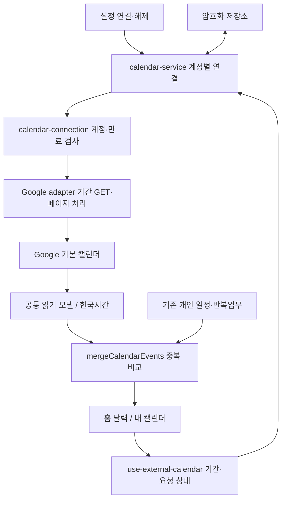

# Google 일정 조회 구조 검수

기준: main의 PR #545 (44619f0). 연결 복원 PR #544와 읽기 V1을 함께 추적.

## 발견 및 보완

1. 중복 비교가 제목·시간만 확인해 Google에서 변경된 장소·메모·임시 상태를 숨길 수 있었다. 비교에 장소·메모·임시 여부를 포함했다. 구글 원본이나 앱 기록은 변경하지 않는다.
2. Hook의 restoring 상태가 두 달력 화면에서 사용되지 않아 연결 복원 중 잠깐 일정 없음으로 보일 수 있었다. 연결 확인 중 표시 및 빈 상태·오늘 건수 확정 억제를 추가했다.

3. 다른 달 조회 결과로 오늘 Google 일정 수를 0건으로 확정할 수 있었다. 오늘이 조회 기간 밖이면 건수는 미확정(—)으로 표시한다.

## 흐름별 확인

| 경계 | 확인 내용 |
| --- | --- |
| 연결/복원 | 별도 암호화 키, 앱 로그인 토큰과 분리. 계정/프로젝트 키. 기존 만료 시각 유지 |
| 조회 | 기존 권한·primary 캘린더 GET. 표시 월/주 기간만. 최대 4페이지 이후 일부 결과 안내 |
| 모델 | 종일 종료일 제외, 한국 날짜/시간, 반복 회차, 취소 제외 |
| 표시 | 출처와 읽기 전용. Google에는 수정·삭제 버튼 없음. 원본 상세 확인 |
| 재조회 | 날짜/월 변경·새로고침·앱 복귀. 오래된 응답은 요청키/연결세대로 차단 |
| 계정 전환 | 기존 계정 결과를 현재 계정 화면에 표시하지 않음. 연결 해제 즉시 비표시 |
| 오류 | 오프라인·권한·만료·일부 결과 안내. 오류를 일정 없음으로 표시하지 않음 |
| 원본/알림 | Google→앱 DB/ERP 복제 또는 추가 알림 없음. 원본 수정 없음 |

## 남은 제한

- 약 50분 이후 재연결 필요. 장기 자동 갱신 미구현.
- 기본 캘린더만 조회. 공유/추가 캘린더 선택 미구현.
- 오프라인 장기 일정 보관 및 양방향 동기화 없음.
- 실제 Google 계정 Android 재실행·복귀 확인과 320/390px 기기 검수는 다음 QA APK 때 필요. 자동 테스트나 목업을 실기기 통과로 해석하지 않음.
- Google 조회는 현재 표시 기간 기준. 오늘이 범위 밖이면 오늘 전체 건수는 —로 표시하고 오늘 화면 복귀 후 확정한다.

사용자 동작 목업은 예시 일정으로 홈·설정·내 캘린더·연결/해제·날짜 선택·새로고침·읽기 전용 상세를 재현한다. 실제 계정/DB에 연결하지 않는다.
