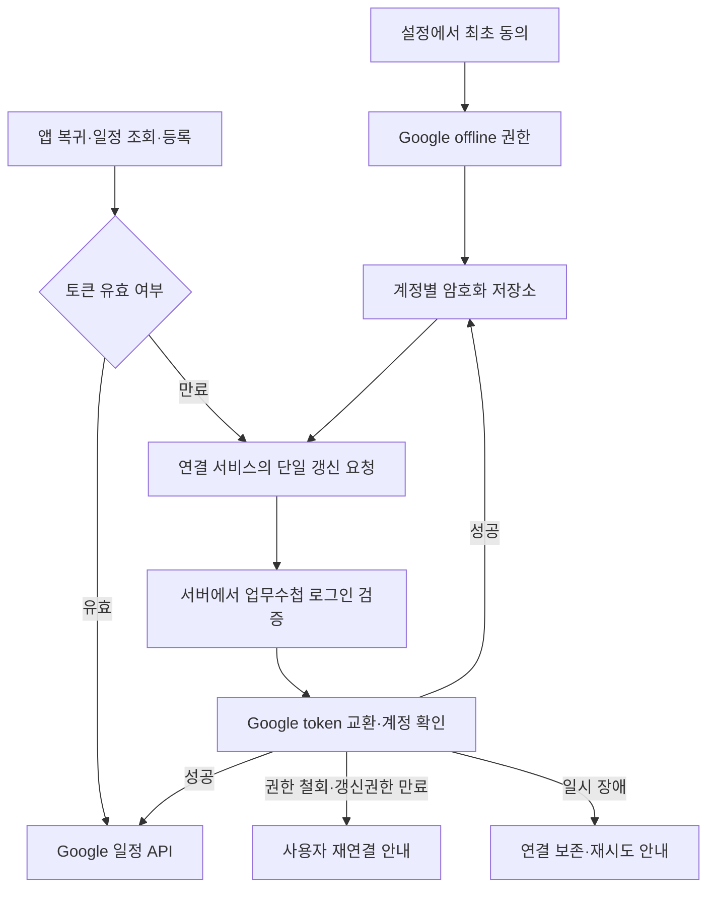

# Google Calendar 자동 인증 갱신

## 정책 확인과 원인

50분마다 사용자에게 재연결을 요구하는 Google 정책은 없다. 기존 앱이 `access_type=online`, 고정 `50 * 60000` 만료값을 사용하고 갱신 구현을 누락했다.

공식 근거:
- https://developers.google.com/identity/protocols/oauth2/web-server#offline
- https://developers.google.com/identity/protocols/oauth2#expiration
- https://supabase.com/docs/guides/auth/social-sign-in/auth-google
- https://supabase.com/docs/guides/auth/social-sign-in

Supabase 앱 세션 갱신과 Google provider token 갱신은 별개다. Supabase는 provider token을 자동 갱신하지 않는다. `offline` 동의에서 받은 `provider_refresh_token`을 별도 암호화 저장하고 Google token endpoint에서 갱신한다. Supabase `expires_in`은 앱 세션 기준이므로 Google 만료값으로 쓰지 않는다.

## 구조

- Google refresh token은 프로젝트+업무수첩 사용자별 기존 암호화 저장소에만 보관한다. 서버/DB에는 저장하지 않는다.
- 서버의 Web OAuth client secret은 앱·Git·응답·로그에 넣지 않는다.
- 갱신 서버는 업무수첩 Supabase JWT를 `/auth/v1/user`에서 확인하고 요청 owner와 비교한다. Google 토큰으로 userinfo를 읽어 기존 Google account ID와 비교한다.
- 처음 연결할 때 갱신을 한 번 검증한다. Google이 반환한 expires_in에서 60초 여유를 두고 갱신 시점을 계산한다. 50분 하드코딩은 제거했다.
- 조회/등록 전에 필요 시 갱신, 동시 요청은 하나로 합침, 401은 최대 1회 갱신 후 재시도한다. 등록은 기존 결정적 event ID/조회 확인을 그대로 유지한다.
- Google 갱신이 invalid_grant를 반환하거나 계정이 달라질 때만 저장된 갱신권한을 지우고 재동의를 요구한다. 네트워크/서버/잘못된 client 설정은 재시도 오류로 처리하고 연결을 유지한다.
- 로그아웃·연결 해제 중 늦게 도착한 갱신 결과는 반영하지 않는다.
- 기존 online 연결에는 refresh token이 없으므로 업데이트 후 최초 1회 다시 연결해야 한다.

## 활성화에 필요한 설정 — 미완료

2026-11-17 Netlify 업무수첩 프로젝트의 환경변수 키 목록을 확인했다. 아래 두 키가 없다. 기존 앱 동작을 깨뜨리지 않도록 서버 준비 및 연결 검수 전에는 이 PR을 QA 출시 후보에 포함하지 않는다.

1. Supabase Google provider에 등록된 **동일한 Web OAuth client**의 ID와 secret을 Netlify 업무수첩 프로젝트 Functions 환경변수에 등록:
   - `GOOGLE_CALENDAR_CLIENT_ID`
   - `GOOGLE_CALENDAR_CLIENT_SECRET`
2. QA가 사용할 배포 컨텍스트와 production에 필요한 범위를 구분해 설정. 새 `/api/google-calendar-refresh` 서버 함수 배포.
3. Google OAuth 동의 화면의 게시 상태 확인. 외부 사용자 + Testing이면 Calendar scope의 refresh token은 7일 만료 대상이다. 이 상태는 Play 비공개 테스트 트랙 또는 QA APK 여부와 다르다. 현재 Google Console 상태는 확인하지 않았다. 승인 없이 게시 상태를 바꾸지 않는다.
4. QA APK 요청 시 최초 1회 동의 → 재시작 → 만료 후 조회/등록 → 권한 철회 → 재연결 실기기 확인. 실제 사용자 일정에 자동 테스트 데이터를 쓰지 않는다.

DB migration은 없다. 신규 SDK/native 권한/패키지도 없다. 서버 설정·배포·실계정 확인 전에는 '연결 유지 문제 해결 완료'로 보고하지 않는다.

## 자동 검증

관련 런타임 61개 PASS (암호화 저장/로그인 격리/갱신/서버 인증/실패 구분/조회/등록/홈/내 캘린더/브라우저 복귀 합성 검증).
TypeScript PASS. 추가 캘린더 범위 검사도 61/61 PASS. Android JS bundle 검증은 자동 승인 검토에서 Expo 외부 통신 가능성을 이유로 차단되어 완료를 주장하지 않는다. 합성 테스트는 실제 Google 계정 또는 실기기 PASS가 아니다.
