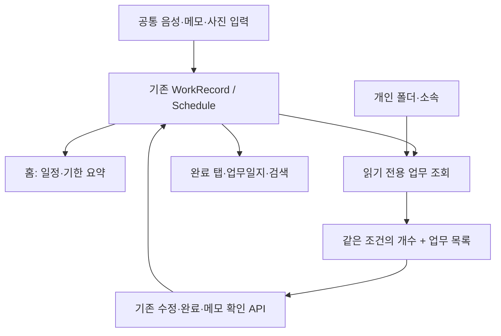

# 홈·업무 단일화 — 사용자 QA #555

## 화면 책임

- 홈: 오늘 일정, 오늘/기한 지남/다가오는 기한 확인. 미분류·메모는 업무 탭 한곳에서 관리.
- 업무: 기본 전체, 명시적 미분류, 폴더 선택 → 할 일/메모·자료/완료 → 기록 목록.
- 폴더 숫자: 하위 폴더를 포함한 **미완료 할 일** 수. 메모·완료 탭을 눌러도 숫자 의미는 바뀌지 않음. 전체 숫자는 중복 없이 계산.
- 오늘 하기/오늘 끝낸 일 카드 및 오늘 선택 버튼 제거. 원본 기록·기존 selected_on 값·구 APK용 RPC는 변경/삭제하지 않음.
- 업무 메뉴: 검색·업무일지·선택 폴더 이름/이동·음성 분류 도움말. 완료 탭에도 날짜별 업무일지 진입점 유지.
- 항목: 제목/해당 폴더/있는 기한만 표시, 수정과 공통 완료 버튼. 이동·알림·삭제는 항목 메뉴. 이동은 목록 아래가 아닌 스크롤 가능한 모달.
- 입력: 홈과 업무 모두 기존 공통 음성·메모·사진 도크. 중복 직접 입력/캡처/회의 버튼 행 제거.
- 도크와 하단 탭은 ScrollView 밖의 일반 flex 영역. 목록 위에 absolute overlay로 띄우지 않음. 기본 높이 축소, 녹음 안내가 있을 때만 별도 안내 여백 확보.
- 업무일지/검색 닫기 시 진입 화면으로 복귀. 업무 범위/탭은 계정별 화면 상태로 유지, 일정에서 전환한 기록은 지정 폴더/종류로 진입.

## 데이터 구조

새 데이터 테이블이나 복사본 없음. `get_my_work_overview` 한 SQL snapshot의 eligible CTE가 개수와 목록의 공통 기준. 페이지 크기 50과 무관하게 전체 집계. 개인 소유권, 반복/취소/연결 일정 제외 기준 유지. SECURITY INVOKER, 빈 search_path, authenticated/service_role만 실행, anon/PUBLIC 차단.

동일 범위 갱신은 확인된 개수와 행 유지. 범위 변경은 이전 범위의 행을 노출하지 않으며, epoch로 지연 응답/계정 unmount 차단. 오류를 빈 목록/0개로 바꾸지 않음. 완료 상태는 기존 status/briefing_state를 사용하며 원문/원래 기록일 보존.

## 검증 및 한계

- 실제 TSX와 핸들러 런타임: 전체/미분류/폴더, 개수, 생성/이름 변경/이동 모달, 키보드 focus/실패 초안 보존, 중복 저장 차단, 완료/수정/삭제/알림 기존 callback, 완료 이력, 검색·일지, stale 응답/계정 경계.
- PGlite 실제 migrations/RLS: 두 계정 격리, 하위 폴더 집계, 미분류, 완료/Undo, 메모 확인 완료, 57건과 50건 페이지, 구 APK RPC와 일정 전환 호환, anon 거절. 운영 사용자 데이터에 테스트 쓰기 없음.
- TypeScript 및 Android JS/Hermes bundle export 검증.
- 320dp 도크 터치 영역 계산 및 기존 녹음 동작 회귀검사. 화면 겹침은 flex 구조로 제거했지만 실제 픽셀 렌더링/휴대폰 키보드 검수는 미완료.
- 로컬 Chromium 실행은 환경 socket 제한, Cloud Browser 로컬 file URL은 정책 제한으로 중단. 이를 우회하지 않았으며 합성 HTML을 실제 기기 검수 증거로 사용하지 않음.
- APK 재생성·Play 배포는 이번 수정 범위에서 실행하지 않음. 사용자 업무시간 개선 수치는 미측정.
