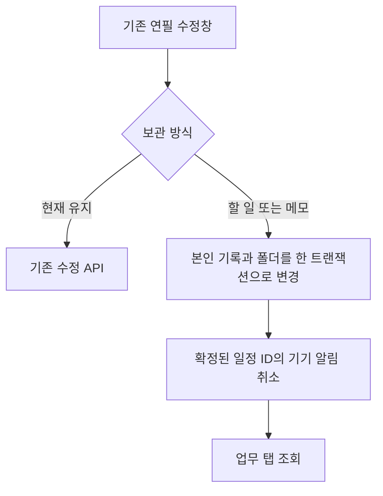
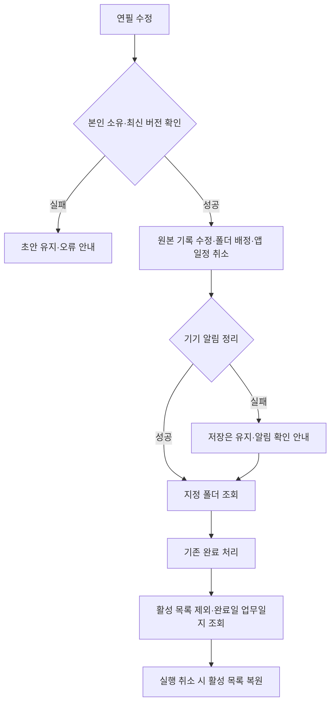

# 연필 수정 → 날짜 없는 할 일/메모 + 폴더

상태: 개발 및 로컬 회귀검사 완료, 운영 DB/APK 미반영.

홈 업무 행의 기존 연필 수정창에서 `현재 유지 / 할 일 / 메모·자료`를 선택한다.
할 일·메모를 선택하면 날짜 입력 대신 기존 개인 폴더와 미분류 선택이 나타난다.
현재 유지로 돌아가면 입력했던 날짜·시간을 복원한다. 저장 성공 후 업무 탭으로 이동한다.

## 데이터 경계

- 신규 복사본 없이 기존 WorkRecord의 제목·종류·기한 및 개인 폴더만 변경한다.
- 원문·본문·작성일·상태를 보존한다. 완료/취소 기록과 반복업무는 이 전환에서 제외한다.
- 개인 workspace 소유자와 작성자 및 현재 로그인 계정을 서버에서 검증한다.
- updated_at과 organization version을 비교해 동시 수정과 응답 유실 후 재전송을 차단한다.
- 폴더 지정·기한 및 재알림 제거·직접 연결/리마인더 Schedule 취소를 한 트랜잭션으로 처리한다.
- Schedule 행과 외부 캘린더 ID를 보존하며 Google API 삭제는 호출하지 않는다.
- 기기 알림 취소 실패는 저장 실패와 분리해 안내하고, 이미 확정된 전환을 다시 쓰지 않는다.
- 서버 RPC 미반영 시 기존 수정은 유지하며 전환 오류를 표시한다.

## 검사 및 반영

로컬 SQL/RLS 실제 실행 및 수정창/저장/실패/계정변경 회귀검사 통과.
타입 검사 통과. 실기기 터치/키보드/알림 전달 및 작업시간 효과는 미측정.

반영 시 migration `20261118003000_work_record_destination.sql`을 검토·적용해야 한다.
#553 메모 완료·업무일지 수정과 별개의 PR이며 해당 기능을 대체하지 않는다.
이전 메모/일정을 일괄 변경하지 않으며 새 APK는 별도 요청 시 누적 빌드한다.

## 최종 통합 구조 검수

#553과 함께 검수했다. 변환 완료 시 지정 폴더 및 할 일/메모 목록을 바로 연다.
계정이 바뀌면 이전 계정의 폴더 선택을 재사용하지 않는다.

- 전환 RPC는 원본 복사/삭제 없이 한 트랜잭션으로 처리한다. 충돌/타인 폴더/반복·완료 기록은 쓰기 전에 거절한다.
- 메모 완료는 기존 acknowledged 상태를 재사용한다. 날짜별 업무일지는 저장 복사본이 아닌 원본 조회다.
- 이미 전송한 Google 일정은 삭제하지 않는다. 사용자에게 별도 확인을 안내한다.
- 서버 기존 조회 함수와 migration을 비교해 일정/기록 조회 조건과 개인 소유권 경계를 보존했음을 확인했다.
- 기존 완료 문구에 묶인 회귀검사를 변경된 완료 안내에 맞췄다.
